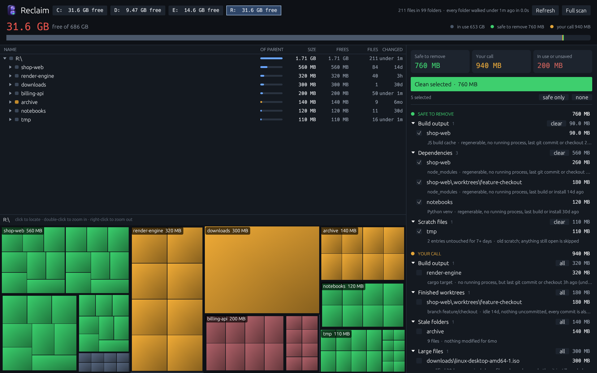

<p align="center">
  
</p>

# Borght Reclaim

Borght Reclaim shows what fills a Windows drive and removes the part you can get back. It is built for developer drives, where most of the space goes to `node_modules`, `bin` and `obj` folders, package caches and git worktrees nobody opened in weeks.

It is one executable, `reclaim.exe`. Start it without arguments for the window, or use the commands in a terminal.



## Why another disk analyzer

WizTree and WinDirStat tell you which folder is big. They don't tell you whether deleting it costs you work. Reclaim answers that second question. Before it offers a folder it checks for running processes, recent edits, uncommitted changes and unpushed commits.

It also needs no administrator rights, and it works on ReFS volumes such as Dev Drive, where tools that parse the NTFS master file table cannot run.

## What it offers to remove

| Kind | Examples |
| --- | --- |
| Build output | .NET `bin` and `obj`, cargo `target`, `.next`, `dist`, test results |
| Dependencies | `node_modules`, Python virtual environments |
| Package caches | npm and npx caches, bun cache entries that no project links to |
| Scratch files | old entries in folders named `tmp` or `temp` |
| Recycle bin | everything in it |
| Finished worktrees | git worktrees with nothing uncommitted whose commits exist elsewhere |
| Global CLI packages | npm global packages that were not updated for a long time |
| Stale folders | large folders nobody modified for 60 days |
| Large files | single files of 256 MB or more |

Every item gets one of three ratings.

- **Safe.** The content can be regenerated and nothing uses it. These are selected by default.
- **Your call.** Removable, with a cost that only you can weigh. A dependency folder you will have to reinstall, a clean worktree, a large file.
- **Blocked.** Belongs to work that is active or not saved anywhere else. Reclaim names the reason, for example "workspace in use by node.exe" or "git repository with 12 uncommitted changes".

## How it keeps active work

- A process whose working directory or command line points into a workspace blocks that workspace.
- A workspace with a file modified in the last 30 minutes is active. Nothing in it is offered.
- Build output is rated safe only after the workspace sat idle for 6 hours. Dependencies need 7 days.
- A worktree is offered only when `git status` is clean and every commit is also on a remote or on another local branch. Reclaim records the commit it verified, and skips the worktree if `HEAD` moved before the delete. Its submodules count too: their repositories live inside the worktree's git folder and go with it, so a submodule with uncommitted or untracked files, a stash, or a commit no remote has blocks the worktree.
- Claude Code session transcripts count as activity, so a checkout an agent used an hour ago is not idle.
- Before deleting a folder Reclaim renames it. Windows refuses the rename when any program has a file open inside, and Reclaim then leaves the folder alone.
- Reclaim never enters `Windows`, `Program Files`, `Program Files (x86)` or `ProgramData`. Under a user profile it leaves `AppData` and dot-folders such as `.vscode` alone, except for git worktrees inside them.
- Junctions and symbolic links are never followed.

Deleting is permanent. Removed files do not go to the Recycle Bin, because the point is to free the space.

## Why it is fast

- It reads each folder with one `GetFileInformationByHandleEx` call that returns names, sizes and file IDs together, on all cores.
- It saves the result. The next start shows the saved numbers at once and reads the volume's change journal to find the folders that changed. Only those are read again.
- It counts a file with several hardlinks once, by file ID. pnpm and bun link the same file into many projects, and a tool that counts paths reports more data than the drive holds.

On the 100 GB ReFS drive this was written for, a repeat scan takes about 4 seconds. On an NTFS system drive the first scan took 100 seconds and repeat scans take 2.

A volume without a change journal is walked in full on every start. A ReFS volume may have none. Create one once from an elevated prompt:

```powershell
fsutil usn createjournal m=33554432 a=4194304 D:
```

## Install

Download `reclaim.exe` from the [releases page](https://github.com/borght-dev/borght-reclaim/releases) and put it in a folder on your `PATH`. There is no installer.

Windows 10 or 11, x64. `git` must be on the `PATH` for the worktree and repository checks.

## Use

```text
reclaim [PATH]                     open the window (default path: config root, else the system drive)
reclaim scan  [PATH] [--top N] [--export FILE.tsv]
                                   print the largest folders; export everything of 16 MB+
reclaim plan  [PATH] [--json]      list what can be removed, and why
reclaim clean [PATH] [--yes] [--include-review]
                                   remove everything rated safe; a dry run without --yes
reclaim config                     print the effective configuration
```

`reclaim clean` without `--yes` deletes nothing. It prints what it would remove. Run that first.

In the window, the buttons in the header switch between local disks. Click a tile in the treemap to select it, double-click to zoom in, right-click to zoom out. The list on the right holds the clean-up plan. Nothing is deleted until you press Clean and confirm.

## Configuration

Thresholds live in `%USERPROFILE%\.reclaim.json`. Every key is optional. `reclaim config` prints the values in effect.

```json
{
  "root": "D:\\",
  "scratch_directories": ["tmp", "temp"],
  "scratch_max_age_days": 7,
  "active_within_minutes": 30,
  "build_output_idle_hours": 6,
  "dependencies_idle_days": 7,
  "npx_max_age_days": 14,
  "worktree_idle_days": 7,
  "stale_folder_days": 60,
  "stale_folder_megabytes": 100,
  "large_file_megabytes": 256,
  "minimum_candidate_megabytes": 10,
  "protected_paths": ["D:\\Archive"]
}
```

Reclaim offers nothing inside a protected path.

## Build from source

Rust stable with the MSVC toolchain, on Windows.

```powershell
cargo build --release
cargo test
```

The executable is `target\release\reclaim.exe`.

To try the tool without pointing it at real work, build a throwaway tree of fake projects and scan that:

```powershell
.\scripts\New-DemoDrive.ps1 -Path $env:TEMP\reclaim-demo
.\target\release\reclaim.exe $env:TEMP\reclaim-demo
```

## Status

This is version 0.1. The scanner and the rating rules have unit tests and ran against real NTFS and ReFS drives. The delete paths have unit tests too, but far fewer hours on real data. Use the dry run, read the list, and keep backups of anything you cannot recreate.

Known limits:

- Windows only.
- Folders the current user cannot read are counted as unreadable and skipped.
- Git removes a worktree with submodules only when forced, which skips git's own clean check. Reclaim runs its check right before, but the two are not one atomic step.
- Activity detection knows Claude Code sessions. Other agents count only through their running processes and file edits.

## License

MIT. See [LICENSE](LICENSE).
